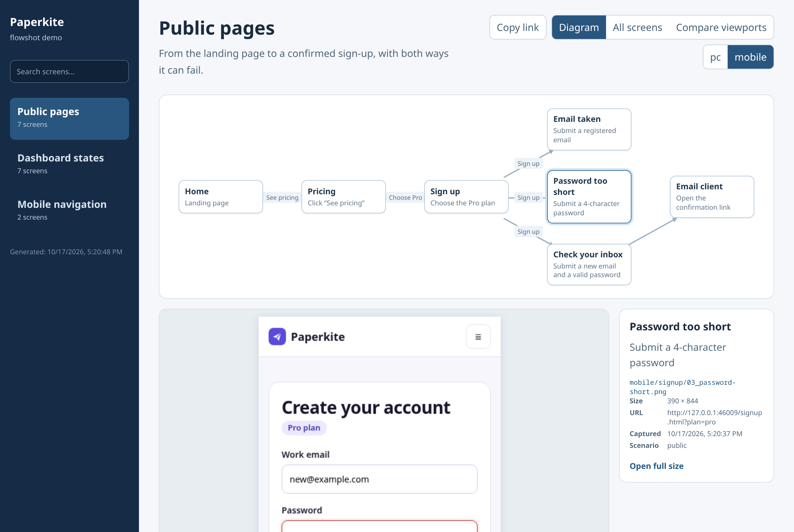
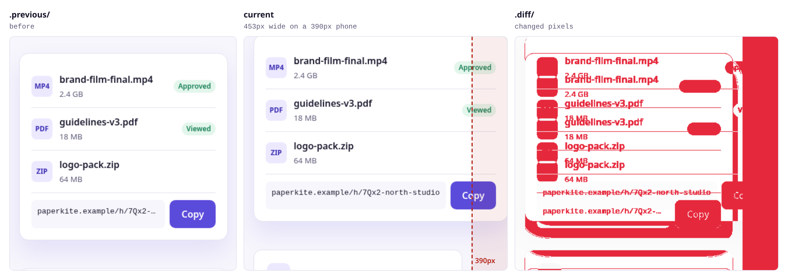
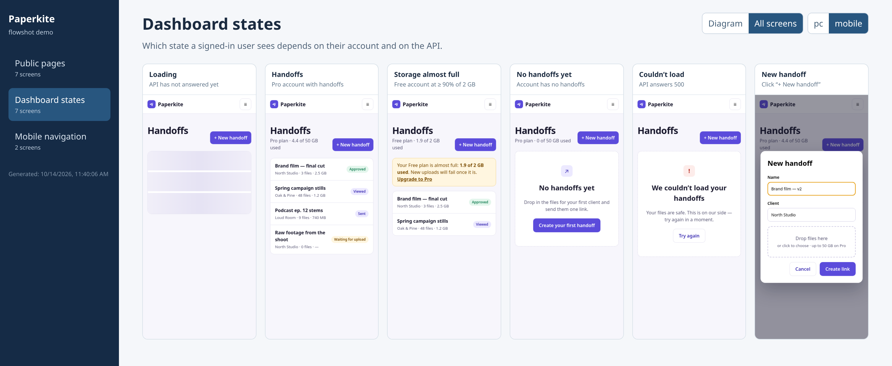
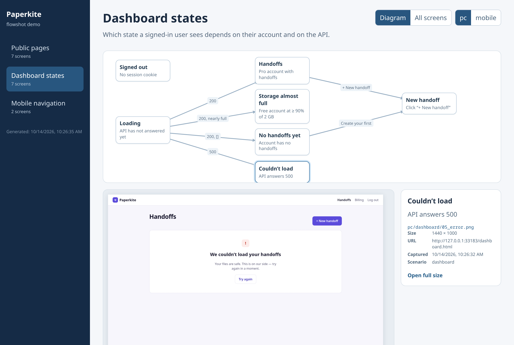
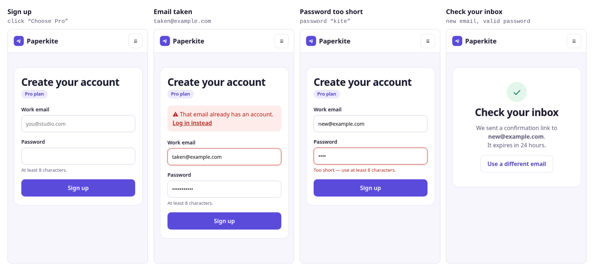
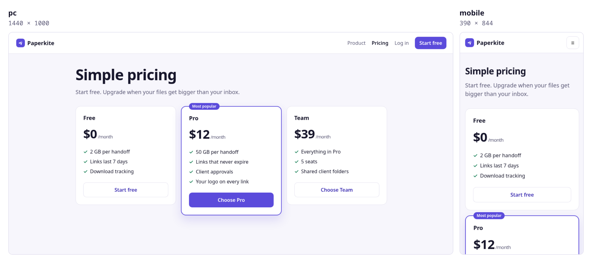
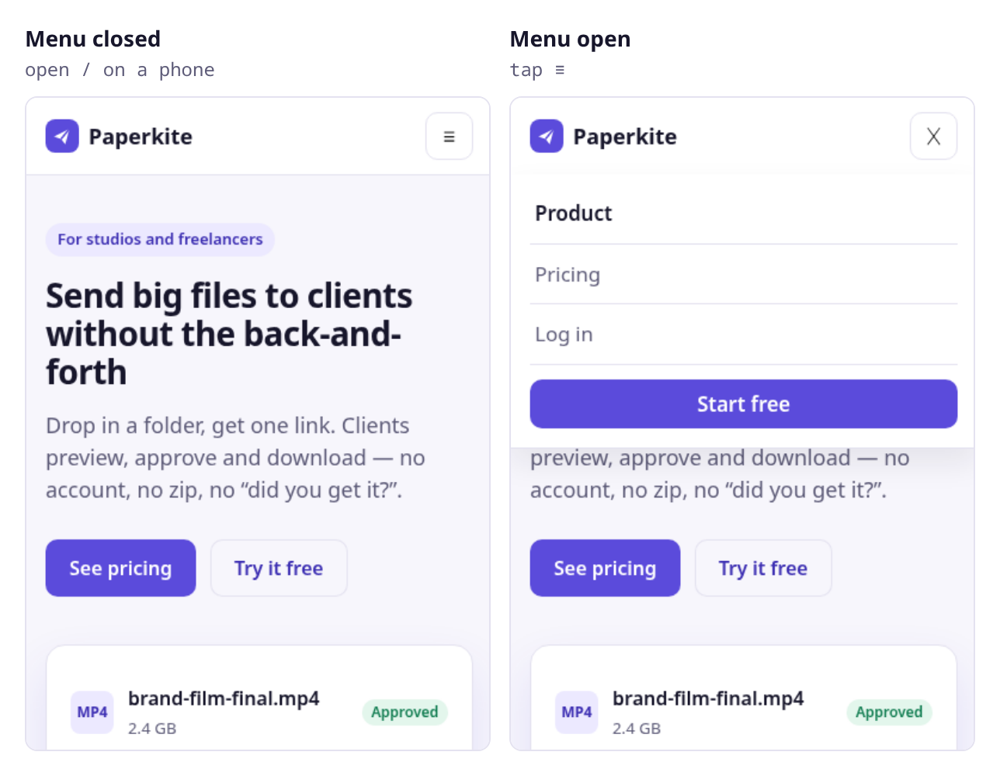

# flowshot

Scenario-driven screenshot capture and flow viewer for web apps — built so that
both people and LLM agents can verify UI changes at real viewport widths.



Every screen *and the reason it appears* — including the error states that
nobody clicks through by hand — on every viewport, in one HTML file.

Then catch the regression before a reviewer does. Drop one `min-width: 0` from
the stylesheet, re-capture only the phone width, and ask what changed:

```console
$ flowshot run --only public --viewport mobile
$ flowshot diff
changed  mobile/public/01_home.png  28.81% of pixels changed  → .diff/mobile/public/01_home.png (before | after | changes)
         ! overflows the 390px viewport by 63px (horizontal scroll)
         ! page is 32px shorter
         region 1: 0,0 453x1460  → .diff/mobile/public/01_home.region-1.png

6 compared: 1 changed, 5 same, 0 new
```



Five screens were unchanged; one now overflows the phone by 63px. The image
above is what `diff` writes: before | after | changes, with the screen edge
marked. An agent gets the same notes and image paths from `diff --json`.

Both images come from the bundled [`example/`](example/) site — a small
fictional product, Paperkite — and are regenerated by `npm run docs:images`.

- **Scenarios** describe how to reach a screen (seed data, mock APIs, click
  through) and what to capture. One browser and one `setup` per scenario;
  viewport captures run with bounded concurrency.
- **Flows** map captures onto transition diagrams so a reviewer can see *why*
  a screen appears, not just what it looks like.
- **`manifest.json`** indexes every capture (path, viewport, size, URL, time)
  so tools — including an LLM that cannot open the HTML viewer — can find,
  compare and inspect screens.
- **Viewer** is a single self-contained `index.html`: searchable screen index,
  a full-flow panel that expands above the selected screenshot, All screens
  grid, side-by-side viewport comparison, and status badges for changed,
  missing, and failed captures. `flowshot diff` adds a changed-only review
  queue with before / after / difference views.

## Examples

All of these are real captures of the bundled [`example/`](example/) site.
`npm run docs:images` regenerates every image in this README.

### Every state of one page

Seeded accounts, mocked API answers, a held-open request and a dialog: one
scenario captures six states of the dashboard. The viewer's **All screens**
view shows them side by side, each with the condition that produces it. Click
a card to open that selected screen, then expand **Full flow** above the
screenshot when its surrounding path matters. The URL hash tracks the selected
flow, screen, viewport, view, and full-flow visibility, so copying or reloading
the URL restores the same state. The old `index.html#grid` link remains
supported.



<details><summary>Scenario (<a href="example/scenarios/dashboard.ts"><code>dashboard.ts</code></a>)</summary>

```ts
async setup({ baseUrl }) {
  return { pro: await createSession(baseUrl, "pro"), free: await createSession(baseUrl, "free") };
},
async capture({ newPage, goto, shoot, state }) {
  const pro = await newPage({ cookies: [{ name: "session", value: state.pro }] });
  await goto(pro, "/dashboard.html");
  await shoot(pro, "dashboard/01_list.png");

  await pro.getByTestId("new-handoff").click();
  await shoot(pro, "dashboard/02_new-dialog.png", { fullPage: false });

  const empty = await newPage({ cookies: [{ name: "session", value: state.pro }] });
  await empty.route("**/api/handoffs", (route) => route.fulfill({ json: { plan: "pro", usedGb: 0, limitGb: 50, handoffs: [] } }));
  // … 500 → route.fulfill({ status: 500 }), loading → a route that never answers
```

</details>

The **Full flow** panel shows how the states connect without hiding the
selected screenshot below it:



### Every way a form ends



<details><summary>Scenario (<a href="example/scenarios/public.ts"><code>public.ts</code></a>): <code>steps</code> with <code>from</code> branch off one screen</summary>

```ts
{ id: "taken", title: "Email taken", condition: "Submit a registered email", via: "Sign up", from: "signup",
  act: async (page) => {
    await page.getByLabel("Work email").fill("taken@example.com");
    await page.getByLabel("Password").fill("password123");
    await page.getByTestId("signup-submit").click();
  },
  waitFor: "signup-error",
  image: "signup/02_email-taken.png" },
{ id: "short", title: "Password too short", from: "signup", /* … */ image: "signup/03_password-short.png" },
{ id: "done", title: "Check your inbox", from: "signup", /* … */ image: "signup/04_done.png" },
```

</details>

### Every viewport



### Phone-only screens



<details><summary>Scenario (<a href="example/scenarios/mobile-only.ts"><code>mobile-only.ts</code></a>)</summary>

```ts
viewports: ["mobile"],
async capture({ newPage, goto, shoot }) {
  const page = await newPage();
  await goto(page, "/");
  await shoot(page, "mobile-nav/01_closed.png", { fullPage: false });
  await page.getByRole("button", { name: "Menu" }).click();
  await shoot(page, "mobile-nav/02_open.png", { fullPage: false });
},
```

</details>

## Let your coding agent drive it

flowshot ships [Agent Skills](https://agentskills.io) — plain `SKILL.md`
files that Claude Code, Codex and other coding agents load on their own.
With them installed, an agent that touches the UI re-captures only the
screens it changed, diffs them, reads the changed regions and tells you what
it saw — without being asked to use flowshot.

A real Claude Code session on the example site, after removing the two
`min-width: 0` rules from its stylesheet. The prompt is all the user typed:


### Install the skills

| agent | command | where the skills go |
| --- | --- | --- |
| Claude Code | `npx flowshot init` | `.claude/skills/` |
| Codex | `npx flowshot init --skills-dir .agents/skills` | `.agents/skills/` |
| any other agent that reads `SKILL.md` | `npx flowshot init --skills-dir <its skills directory>` | |

`init` also writes a starter config and scenario if they are missing. Run it
again with `--force` after upgrading flowshot to refresh the skills. Commit
them so everyone working in the repository gets them.

Codex: in our test (codex-cli 0.162 on Linux) Chromium could not start inside
Codex's default `workspace-write` sandbox, so `flowshot run` failed and the
agent fell back to checking the page another way. Give Codex a sandbox
policy that lets it launch a browser, or run the captures yourself and let
it read the results.

### What each skill does

| skill | the agent uses it when… | for example, you say |
| --- | --- | --- |
| `flowshot-verify` | it changed CSS, layout or a page component, or you ask how a screen looks | “Does the home page still look right on mobile?” |
| `flowshot-scenario` | a screen, route, modal or error state was added or renamed | “Add the new billing error to the captures.” |
| `flowshot-triage` | a run fails or a capture shows the wrong screen | “flowshot run fails on the dashboard scenario.” |
| `flowshot-coverage` | you ask what the captures miss | “Which screens aren’t captured yet?” |

### Tell it about your project

The skills are generic. Put what only your project knows in the file your
agent reads at the start of a session (`CLAUDE.md`, `AGENTS.md`): how to
start the app, how to seed data, test ids. The session above ran with only
this:

```markdown
Static site in `site/`. The dev server is already running at http://127.0.0.1:4173 — do not start another.
Screens are captured with flowshot (config `flowshot.config.ts`, scenarios in `flowshot/scenarios/`).
Viewports: pc 1440px, mobile 390px.
```

### Without skills

The CLI works the same when you drive it by hand:

1. `flowshot list --json` → find the capture for the screen you touched.
2. `flowshot run --only <scenario> --viewport mobile --no-viewer` → re-capture just that.
3. `flowshot diff --only <scenario>` → notes and changed regions; read each region's `.region-<n>.png`.
4. `flowshot lint --json` → nothing missing, nothing orphaned.

## Install

Written in TypeScript, ships with type declarations, zero runtime
dependencies (Playwright is a peer).

The package is `@keyhole-koro/flowshot` (the unscoped `flowshot` on npm is
an unrelated project); the CLI is still `npx flowshot`. Until it is
published, install from GitHub or as a git submodule — both put it at
`node_modules/@keyhole-koro/flowshot`, so
`import { defineScenario } from "@keyhole-koro/flowshot"` works either way.

### Requirements

- Node ≥ 20 to run; Node ≥ 22.18 (or 23.6+) to write config and scenarios
  in TypeScript, which Node then runs directly by stripping types
- Playwright ≥ 1.40 in your project (`npm i -D playwright`)
- A running instance of the app you want to capture; flowshot does not
  start it

### Option A — from GitHub

```bash
npm install --save-dev github:Keyhole-Koro/flowshot playwright
npx playwright install chromium
```

npm runs the package's `prepare` script on install, which compiles
`src/` to `dist/`. Pin a commit with `github:Keyhole-Koro/flowshot#<sha>`.
Once published: `npm install --save-dev @keyhole-koro/flowshot playwright`.

### Option B — git submodule (when you want to hack on flowshot too)

```bash
git submodule add git@github.com:Keyhole-Koro/flowshot.git tools/flowshot
npm install --save-dev file:tools/flowshot playwright
npx playwright install chromium
```

`node_modules/flowshot` becomes a symlink to `tools/flowshot`, and
`npm install` builds `dist/` there. After pulling flowshot changes run
`npm --prefix tools/flowshot run build`. Fresh clones need
`git submodule update --init tools/flowshot` before `npm install`. Builds
that skip the submodule (Docker images that only copy `package*.json`)
still pass `npm ci`; the link just dangles.

## Set up a project

1. **Scaffold.** From the project root:

   ```bash
   npx flowshot init
   ```

   This writes `flowshot.config.ts` and `flowshot/scenarios/public.ts`
   (`.mjs` on Node < 22.18; `--force` to overwrite) and copies the Claude Code
   skills into `.claude/skills/`. In a project whose `package.json` has no
   `"type": "module"`, rename the two files to `.mts` so Node treats them as
   ES modules without a warning; flowshot discovers `flowshot.config.mts` too.

2. **Point it at your app.** Edit the config: `baseUrl`, the viewports you
   care about, `warmUp` routes if your dev server compiles on demand (Vite),
   and a `beforeShoot` hook if pages render data client-side after load:

   ```ts
   beforeShoot: async (page) => {
     await page.waitForFunction(() => document.body.innerText.trim().length > 80).catch(() => {});
   },
   ```

   `concurrency: "auto"` (the default) selects up to four workers from the
   available CPU count. Viewport captures share the `setup()` state; set
   `concurrency: 1` if they mutate that state and must run in order.

3. **Write scenarios** under `flowshot/scenarios/` — one file per user path
   (see [Quick start](#quick-start) and [Scenario API](#scenario-api)).
   Seed state in `setup()` (write to your DB or call your API), inject a
   session cookie with `newPage({ cookies })`, mock hard-to-reach states with
   `page.route()`. Keep project helpers in `flowshot/lib/`.

4. **Capture.** Start the app, then:

   ```bash
   npx flowshot run           # everything
   npx flowshot run --concurrency 2  # limit to two viewport workers
   npx flowshot lint          # every flow node captured, nothing orphaned
   ```

   Open `output/captures/index.html`. Add `output/captures/` to
   `.gitignore`.

5. **Wire it in.** Suggested `package.json` scripts:

   ```json
   "capture": "flowshot run",
   "capture:viewer": "flowshot viewer",
   "capture:lint": "flowshot lint"
   ```

   For TypeScript projects, include the files in your `tsconfig.json` so
   `tsc --noEmit` checks them: `"include": ["flowshot/**/*.mts", "flowshot.config.mts"]`
   plus `"allowImportingTsExtensions": true` if scenarios import each other
   with `.mts` extensions.

6. **CI (optional).** Capture on every PR and publish the viewer as an
   artifact:

   ```yaml
   - run: npx playwright install --with-deps chromium
   - run: npm run dev &            # or however the app starts
   - run: npx wait-on http://localhost:3000
   - run: npx flowshot run --json > flowshot-summary.json
   - uses: actions/upload-artifact@v4
     with: { name: captures, path: output/captures }
   ```

   `run` exits 1 when a scenario fails; `lint` exits 1 when a flow node has
   no capture.

7. **Let the agent use it.** The skills copied in step 1 teach your coding
   agent to re-capture, diff and read only the screens it touched — see
   [Let your coding agent drive it](#let-your-coding-agent-drive-it) (Codex:
   `--skills-dir .agents/skills`).

## Quick start

`flowshot.config.ts` in your project root:

```ts
import { defineConfig } from "@keyhole-koro/flowshot";

export default defineConfig({
  baseUrl: "http://localhost:3000",
  outDir: "output/captures",
  concurrency: "auto",
  scenarios: ["captures/scenarios/*.ts"],
  viewports: [
    { name: "pc", width: 1440, height: 1000 },
    { name: "mobile", width: 390, height: 844, isMobile: true, hasTouch: true },
  ],
});
```

`captures/scenarios/public.ts`:

```ts
import { defineScenario } from "@keyhole-koro/flowshot";

export default defineScenario({
  id: "public",
  title: "Public pages",
  async capture({ newPage, goto, shoot }) {
    const page = await newPage();
    await goto(page, "/");
    await shoot(page, "public/01_home.png");
    await goto(page, "/pricing");
    await shoot(page, "public/02_pricing.png");
  },
  flows: [
    {
      id: "public",
      title: "Public pages",
      nodes: [
        { id: "home", title: "Home", condition: "Landing", image: "public/01_home.png", x: 25, y: 50 },
        { id: "pricing", title: "Pricing", condition: "Click “Pricing”", image: "public/02_pricing.png", x: 70, y: 50 },
      ],
      edges: [["home", "pricing", "Pricing"]],
    },
  ],
});
```

Or let flowshot generate the flow from a list of steps:

```ts
export default defineScenario({
  id: "public",
  title: "Public pages",
  steps: [
    { id: "home", title: "Home", condition: "Landing", goto: "/", image: "public/01_home.png" },
    { id: "pricing", title: "Pricing", via: "Pricing",
      act: async (page) => { await page.getByRole("link", { name: "Pricing" }).click(); await page.waitForURL(/pricing/); },
      image: "public/02_pricing.png" },
  ],
});
```

Then, with your app running:

```bash
npx flowshot run            # captures every scenario × viewport, writes manifest.json + index.html
npx flowshot run --only public --viewport mobile
npx flowshot list --json    # scenarios, viewports and captures as JSON
npx flowshot lint           # flow nodes without captures, captures without flows, last-run failures
npx flowshot diff           # what changed since the previous run (pixel diff + highlight images)
npx flowshot inspect public/01_home --viewport mobile --tile 1200   # split a tall capture for reading
npx flowshot viewer         # rebuild index.html from manifest.json only
npx flowshot init           # starter config + copy the bundled agent skills into .claude/skills/ (--skills-dir for others)
```

Open `output/captures/index.html` in a browser. The viewer keeps the selected
flow, screen, viewport, view mode, and full-flow visibility in the URL hash, so
reloading or sharing that URL opens the same state. **Full flow** expands the
transition diagram directly above the selected screenshot and stays open while
nodes are selected; large diagrams scroll inside that panel. Use `/` to search,
←/→ to move between screens, `g` to toggle the full flow, and `n`/`p` to move
through visual changes. `npx flowshot help` lists every option.

A runnable example lives in [`example/`](example/): `npm run example` serves
a static site on :4173, `npm run example:capture` captures it.

## Scenario API

```js
defineScenario({
  id,               // [a-z0-9-], unique; used by --only and the manifest
  title, description,
  order,            // sort key for run and viewer order (default 0, then file path)
  viewports,        // optional subset of config viewport names
  async setup({ config, baseUrl, log }) {},        // once per scenario → state
  async capture(ctx) {},                           // once per viewport (or use `steps`)
  async teardown({ config, baseUrl, state, log }) {},
  flows: [ { id, title, description, viewports?, diagramHeight?, nodes, edges } ],

  // Declarative alternative to capture(): one shared page, one node per step.
  page,             // options for that page, or ({ state }) => options (e.g. cookies)
  async prepare(page, ctx) {},                     // route mocks etc. before the first step
  steps: [ { id, title, condition, goto, act, waitFor, image, from, via, viewports, note, x, y } ],
  flow,             // overrides for the generated flow (title, description, diagramHeight, viewports)
});
```

Steps run in order on the shared page: `goto` (path or `(state) => path`),
then `act(page, ctx)`, then `waitFor` (a test id, or `(page, ctx) => …`), then
`shoot(image)` if `image` is set. Edges default to “previous step → this
step”; `from` (`"id"`, `["a", "b"]`, or `null`) and `via` (label) override.
Positions come from a layered layout unless a step sets `x`/`y` (%).

`capture(ctx)` receives:

| helper | what it does |
| --- | --- |
| `ctx.newContext({ cookies, ...playwrightOptions })` | Browser context sized for the current viewport. `cookies: [{ name, value }]` are added for `baseUrl`. Contexts are closed for you. |
| `ctx.newPage(options)` | `newContext` + `newPage`. |
| `ctx.goto(page, "/path", options)` | `page.goto(baseUrl + path)`, `waitUntil: "networkidle"` by default. |
| `ctx.shoot(page, "dir/01_name.png", { fullPage = true })` | Saves `<outDir>/<viewport>/dir/01_name.png` and records it in the manifest. Waits for fonts and `settleMs` first. |
| `ctx.viewport`, `ctx.state`, `ctx.baseUrl`, `ctx.config`, `ctx.log`, `ctx.browser` | Plain data. |

Flow nodes reference images by the path passed to `shoot` (without the
viewport prefix); the viewer resolves the viewport at display time. A node
without `image` is a transition target (e.g. “redirect back”); give it a
`note` to explain.

## Config

| key | default | notes |
| --- | --- | --- |
| `baseUrl` | `http://localhost:3000` | env `BASE_URL` overrides |
| `outDir` | `output/captures` | env `OUT_DIR` overrides; relative to the config file |
| `concurrency` | `"auto"` | concurrent viewport captures; auto uses half the available CPUs, up to 4 workers; set an integer from 1 to 32 to choose explicitly |
| `scenarios` | `flowshot/scenarios/*.{mjs,ts,mts}` | globs (`*`, `**`) or file paths |
| `viewports` | pc 1440×1000, mobile 390×844 | `{ name, width, height, isMobile?, hasTouch? }` |
| `settleMs` | `600` | quiet time before each screenshot |
| `beforeShoot` | `null` | `async (page, { viewport, scenario, path })` hook, e.g. wait for client-side data |
| `warmUp` | `[]` | routes to visit once before capturing (on-demand dev servers) |
| `launch` | `{ args: ["--no-sandbox"] }` | `chromium.launch()` options; env `CHROMIUM_EXECUTABLE_PATH` sets `executablePath` |
| `viewer.title`, `viewer.subtitle`, `viewer.lang` | `flowshot` / … / `en` | |
| `viewer.viewportLabels` | viewport names | `{ pc: "PC", mobile: "Mobile" }` |
| `viewer.labels` | English | every UI string in the viewer, for localisation |

## Output

```
output/captures/
  manifest.json          # { version, generatedAt, baseUrl, viewports, scenarios, failures, captures[] }
  index.html             # the viewer
  pc/<dir>/<name>.png
  mobile/<dir>/<name>.png
  .previous/             # the versions overwritten by the last run (for `diff`)
  .diff/                 # results.json + highlight images written by `diff`
  .inspect/              # crops and tiles written by `inspect`
```

`run --only <id> [--viewport v]` replaces only the matching entries in the
manifest, so partial re-captures keep the index whole. Failures do not abort
the run by default (`--fail-fast` to change); they are listed at the end, in
the manifest, and the exit code is 1. `run --concurrency <auto|n>` overrides
the config setting for one run. `--fail-fast` waits for already-running
viewport captures to finish before stopping.

### diff

`flowshot diff [--against <dir>] [--only <id,...>] [--viewport <v,...>] [--threshold 0.0005] [--json]`

Compares each capture with `.previous/` (or any directory with the same
layout, e.g. captures from another branch). A pixel counts as changed when
any channel differs by more than 16; a capture counts as changed above the
threshold ratio or when its size changed. For each changed capture you get:

- **notes** in plain words when the size changed — `overflows the 390px
  viewport by 63px (horizontal scroll)`, `page is 32px shorter`;
- **regions**: separate changed areas in reading order (changes within ~24px
  are merged; the 8 largest are listed);
- `.diff/<path>` — before | after | changes side by side, every region boxed
  in blue, the viewport edge dashed in red when a page overflows;
- `.diff/<path minus .png>.region-<n>.png` — the same three panels cropped to
  one region, small enough to read directly.

The latest report is saved to `.diff/results.json`, and `diff` rebuilds the
viewer so changed captures can be reviewed there immediately. A report is only
shown when it matches the current manifest, preventing stale results after a
new capture run.

No dependencies: the PNG codec is built in.

### inspect

`flowshot inspect <capture> [--viewport <v>] [--crop x,y,w,h | --tile <height>] [--json]`

Writes crops or overlapping tiles of a capture under `.inspect/` so an agent
that reads images can look at a 390×8000 page piece by piece. `<capture>` is
an id (`app/billing/01_overview`), a viewport path, or a `.diff/…` path.

## Releasing

`npm version <patch|minor|major>` bumps `package.json` and creates a `vX.Y.Z`
tag; `git push --follow-tags` triggers [`publish.yml`](.github/workflows/publish.yml),
which runs the tests and publishes with provenance. Auth is either npm
trusted publishing (configure this repository and workflow on the package's
npm settings) or an `NPM_TOKEN` repository secret (granular token with
2FA bypass).

## Development

```bash
npm ci && npx playwright install chromium
npm run build       # tsc → dist/ (Node code), dist/viewer/client.js (browser), assets
npm test            # builds, then node --test: end-to-end against example/ plus unit checks
npm run example     # serve example/ on :4173; then npm run example:capture
```

Everything is TypeScript. `src/` is compiled to `dist/` (Node, ESM,
`NodeNext`); `src/viewer/client.ts` is compiled separately into the browser
script inlined in `index.html`; `example/` and `test/` run uncompiled on
Node's type stripping (so developing flowshot needs Node ≥ 22.18, using it
does not). `skills/` holds the agent skills copied by `flowshot init`,
`docs/` the README images, which `npm run docs:images` regenerates from the
example (`scripts/readme-images.ts`).

## Roadmap

- `diff --against git:<ref>` — compare with captures committed or stashed on another ref
- Ignore regions / masks for known-dynamic areas
- Per-flow HTML export for sharing a single diagram

## License

MIT
